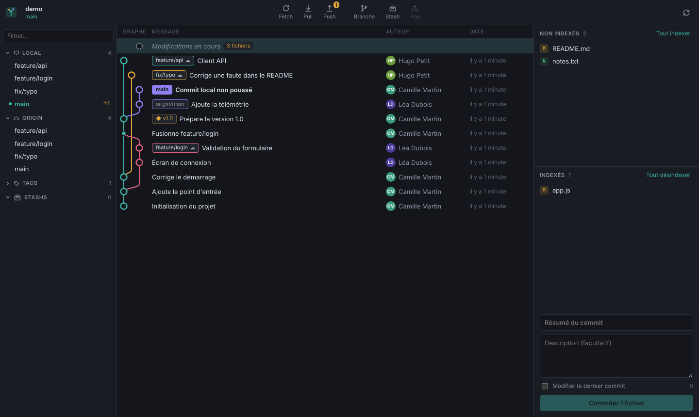
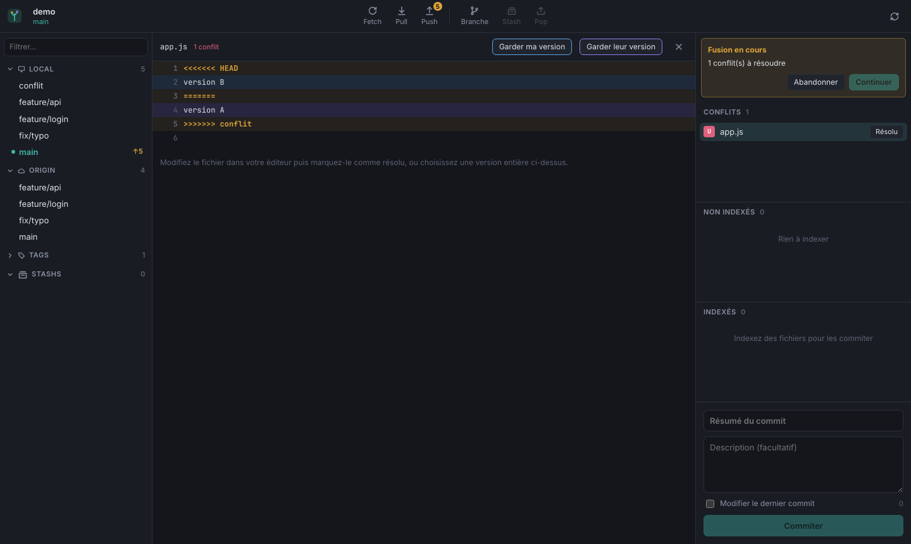

# Arbor

Arbor est un client Git graphique pour bureau (Windows, macOS, Linux) : graphe de commits, branches, indexation, diff, fusion, rebase, stash et résolution de conflits, le tout à la souris.



## Démarrer

Prérequis : Node.js 20+ et Git installé sur la machine.

```bash
npm install
npm run dev            # mode développement (rechargement à chaud)
npm start              # build puis lancement
npm start -- /chemin/vers/un/depot   # ouvre directement un dépôt
npm test               # tests unitaires
```

## Fonctionnalités (v0.1)

- **Dépôts** : ouvrir, initialiser, cloner, liste des dépôts récents.
- **Graphe** : toutes les branches, couleurs par ligne, badges de branches/tags/remotes, défilement virtualisé, navigation au clavier.
- **Modifications en cours** : indexer/désindexer fichier par fichier ou tout, annuler des modifications, commit avec résumé + description, modification du dernier commit (amend).
- **Diff** : vue unifiée ou côte à côte, pour le répertoire de travail comme pour n'importe quel commit.
- **Branches** : checkout (double-clic), création, suppression, suivi automatique des branches distantes.
- **Remotes** : fetch, pull, push (avec publication d'une nouvelle branche), compteurs en avance/en retard.
- **Fusion et rebase** depuis le menu contextuel d'une branche, avec bandeau Continuer/Abandonner.
- **Conflits** : vue dédiée qui met en évidence les deux versions, « garder ma version » / « garder leur version ».
- **Stash** : mettre de côté, appliquer, pop, supprimer.
- **Commits** : cherry-pick, revert, reset soft/mixed/hard, tag, branche depuis un commit, copie du SHA.



## Architecture

| Dossier | Rôle |
| --- | --- |
| `src/main` | Processus principal Electron. `git.ts` appelle le binaire `git` et analyse sa sortie. |
| `src/shared` | Types partagés et contrat de l'API exposée au rendu. |
| `src/renderer` | Interface React. `graph.ts` calcule la disposition du graphe, `diff.ts` analyse les patchs. |

Le rendu n'a aucun accès direct au système : toutes les commandes passent par l'IPC (`window.arbor`).

## Feuille de route

1. Indexation par bloc (hunk) et par ligne, recherche dans l'historique.
2. Rebase interactif (glisser-déposer), éditeur de fusion à trois panneaux.
3. Authentification GitHub/GitLab, pull requests, gestion des remotes.
4. Thème clair, raccourcis configurables, paquets d'installation (electron-builder).
