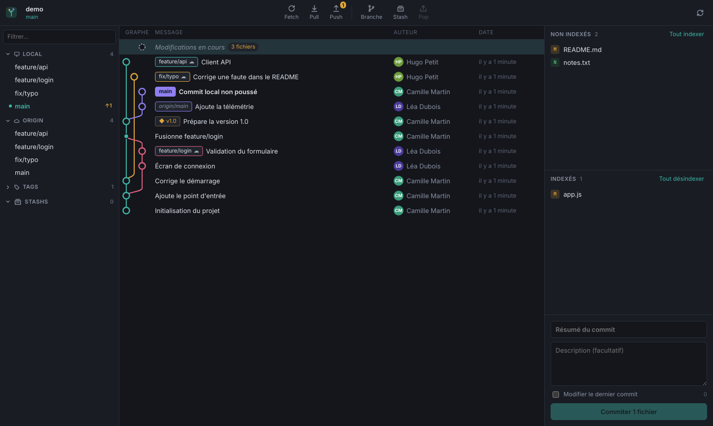
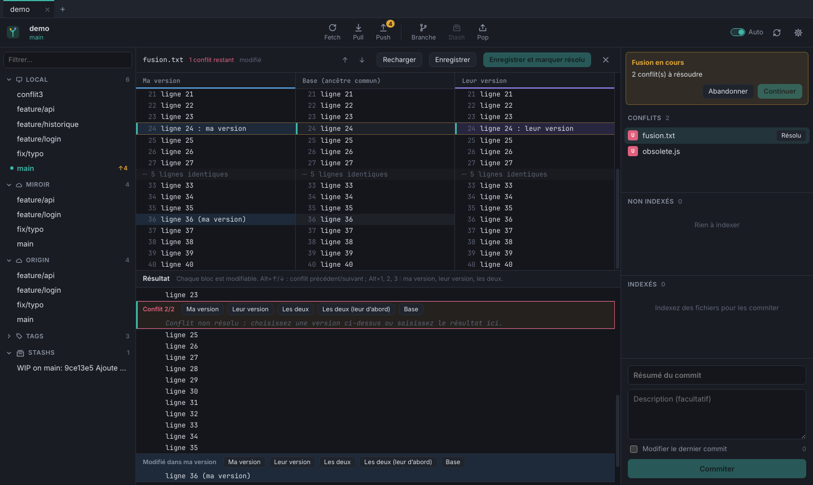

# Arbor

Arbor est un client Git graphique pour bureau (Windows, macOS, Linux) : graphe de commits, branches, indexation, diff, fusion, rebase, stash et résolution de conflits, le tout à la souris.



## Démarrer

Prérequis : Node.js 20+ et Git installé sur la machine (2.27 ou plus récent).

```bash
npm install
npm run dev            # mode développement (rechargement à chaud)
npm start              # build puis lancement
npm start -- /chemin/vers/un/depot   # ouvre directement un dépôt
npm test               # tests unitaires
```

## Fonctionnalités (v0.2)

- **Dépôts** : ouvrir, initialiser, cloner, liste des dépôts récents.
- **Graphe** : toutes les branches, couleurs par ligne, badges de branches/tags/remotes, défilement virtualisé, navigation au clavier.
- **Recherche dans l'historique** (Ctrl+F) : par message, auteur, préfixe de SHA ou fichier modifié, insensible à la casse et aux accents (le mode Fichier ignore la casse ASCII mais pas les accents) ; correspondances mises en évidence, navigation Entrée / Maj+Entrée.
- **Modifications en cours** : indexer/désindexer fichier par fichier ou tout, annuler des modifications, commit avec résumé + description, modification du dernier commit (amend).
- **Diff** : vue unifiée ou côte à côte, pour le répertoire de travail comme pour n'importe quel commit.
- **Indexation partielle** : depuis le diff, indexer, désindexer ou annuler un bloc entier, ou seulement les lignes sélectionnées (clic sur le numéro, Maj+clic pour une plage).
- **Branches** : checkout (double-clic), création, suppression, suivi automatique des branches distantes.
- **Remotes** : fetch, pull, push (avec publication d'une nouvelle branche), compteurs en avance/en retard.
- **Rafraîchissement automatique** : l'interface suit les changements faits hors d'Arbor (terminal, éditeur), fichiers ignorés exclus, sans boucle ; interrupteur « Auto » dans la barre d'outils.
- **Fusion et rebase** depuis le menu contextuel d'une branche, avec bandeau Continuer/Passer/Abandonner.
- **Conflits** : vue dédiée qui met en évidence les deux versions, « garder ma version » / « garder leur version ».
- **Éditeur de fusion à trois panneaux** : fusion calculée par Git (`git merge-file --diff3`, filtres du dépôt appliqués), ma version, base et leur version alignées bloc par bloc, résultat modifiable en bas (un segment par bloc), changements sans conflit appliqués d'office, choix par conflit (ma version, leur version, les deux, base), Alt+↑/↓ et Alt+1/2/3 (aussi dans la palette), défilement synchronisé ; « ma version » reste la vôtre pendant un rebase (pas d'inversion pendant `git am`) ; fins de ligne CRLF, saut final et bit exécutable conservés, écriture atomique ; avertissement si le fichier a déjà été modifié (résolution commencée ailleurs, rerere) ; enregistrement refusé si le fichier a changé pendant l'édition ; conflits suppression/modification (garder ou supprimer le fichier). Repli sur la vue simple pour les fichiers binaires, filtrés (LFS…), de plus de 1 Mo, 20 000 lignes ou 2 000 blocs, les sous-modules et les liens symboliques.
  Les brouillons de l'éditeur restent en mémoire seulement : ils survivent au changement d'onglet ou de fichier, pas à la fermeture d'Arbor.
- **Stash** : mettre de côté, appliquer, pop, supprimer.
- **Commits** : cherry-pick, revert, reset soft/mixed/hard, tag, branche depuis un commit, copie du SHA.
- **Historique d'un fichier et blame** : clic droit sur un fichier, liste des commits qui l'ont modifié (renommages suivis) avec le diff de chaque version, blame ligne par ligne (lignes non commitées comprises) qui renvoie vers les commits.
- **Thème clair et préférences** (Ctrl/Cmd+, ou engrenage) : thème clair, sombre ou celui du système, taille du code des diffs, police à chasse fixe (code, diffs, blame, identifiants de commit), mode de diff par défaut, rafraîchissement automatique, réouverture des onglets ; enregistrées immédiatement et conservées au redémarrage, sans flash sombre au lancement.
- **Palette de commandes** (Ctrl/Cmd+Maj+P ou Ctrl/Cmd+K) : recherche floue, insensible aux accents, sur les commandes (fetch, pull, push, commit, stash, nouvelle branche, continuer/abandonner…), les branches et tags, les dépôts récents et les fichiers modifiés ; préfixes `>` commandes, `@` branches, `#` fichiers ; seules les commandes possibles dans l'état du dépôt sont proposées.
- **Onglets multi-dépôts** : un onglet par dépôt (Ctrl/Cmd+T, Ctrl/Cmd+W, Ctrl+Tab / Ctrl+Maj+Tab, clic du milieu), chaque onglet garde sa sélection, son diff, son brouillon de commit, le défilement du graphe (ancré sur le commit en haut de la vue, conservé aussi à la fermeture d'un diff), ses sections repliées, le filtre de la barre latérale et sa recherche ; seul l'onglet actif est surveillé ; onglets rouverts au redémarrage (préférence « restaurer les onglets ») avec leur sélection, leur défilement, leurs sections, leur filtre et leur recherche (pas le brouillon), dépôts supprimés écartés, dépôts momentanément inaccessibles (disque externe, partage réseau) gardés et rouverts au lancement suivant ; dépôts de même nom distingués par leur dossier parent. Barre latérale et panneau de droite redimensionnables (séparateurs à glisser, ou ←/→ par pas de 16 px une fois sélectionnés au clavier, Origine/Fin, double-clic pour la largeur par défaut) ; largeurs communes à tous les onglets, conservées dans les préférences.
- **Rebase interactif** (clic droit sur un commit « Rebase interactif à partir d'ici… », sur une branche, ou palette) : liste des commits plus récent en haut, réordonnés par glisser-déposer ou Alt+↑/↓, actions pick/reword/edit/squash/fixup/drop (touches p r e s f d), messages saisis avant de démarrer, commits déjà publiés signalés ; refusé s'il y a des modifications locales ou des fusions dans la plage. Le bandeau affiche l'étape, le commit d'arrêt (edit, conflit) et les étapes restantes, avec Continuer, Passer et Abandonner.
- **Gestion des remotes** : ajouter (URL de push facultative, fetch immédiat), renommer, supprimer (avec confirmation), modifier l'URL de fetch ou de push (valeurs brutes de la configuration, avant `insteadOf` ; push vide = même URL que le fetch), fetch ou prune d'un seul remote, copie de l'URL ; « + » et bouton Fetch dans l'en-tête des remotes, URL en infobulle, commandes de palette « Ajouter un remote… », « Fetch <remote> », « Prune <remote> ».
- **Tags** : création légère ou annotée (message multiligne) sur n'importe quel commit, avec publication immédiate facultative ; section de la barre latérale (clic = sélection du commit, double-clic = checkout de `refs/tags/<nom>`, « + » = tag sur HEAD, infobulle du message) ; menu du tag dans la barre latérale et sur les badges du graphe (checkout, pousser vers un remote, supprimer en local et sur le remote si le tag y est présent, copier le nom) ; palette : « Créer un tag… », « Pousser tous les tags vers <remote> ».
- **Annulation par le reflog** : bouton Annuler de la barre d'outils (et palette « Annuler la dernière opération ») qui ramène la branche extraite à son état précédent d'après son reflog, après confirmation : `reset --soft` après un commit ou un amend (les changements restent indexés), `reset --keep` après une fusion, un pull, un rebase, un reset, un cherry-pick ou un revert (modifications locales conservées, refus de Git si elles seraient écrasées) ; refusé en HEAD détachée, pendant une opération ou si la branche a changé depuis l'affichage ; les commits retirés restent dans le reflog (Annuler à nouveau rétablit l'état). Palette « Afficher le reflog… » : reflog de la branche ou de HEAD par pages de 200, date de chaque opération, retour à n'importe quel état par « Reset (keep) » avec confirmation. Pas de Ctrl+Z.
- **Glisser-déposer de branches** : une branche (badge du graphe ou barre latérale, locale ou distante) déposée sur une branche, un commit ou un remote ouvre un menu d'actions, jamais une action directe : fusionner dans la branche courante ; sur une autre branche, avance rapide sans checkout (refusée s'il n'y a pas d'avance rapide, si la branche a changé ou si elle est extraite dans un autre worktree) ou « basculer puis fusionner » ; rebase (aussi d'une branche non courante, qui est alors extraite), avec case « Mettre de côté et réappliquer (autostash) » décochée par défaut, ou rebase interactif ; sur un commit, rebaser ou « Déplacer ici » (branche non courante, confirmé, annulable par le reflog) ; sur un remote, pousser la branche (avec suivi -u si elle n'en a pas). Cible surlignée pendant le survol, défilement automatique du graphe, raisons affichées pour les actions impossibles (opération en cours, même commit…). Au clavier : Maj+F10 ou touche Menu sur une branche de la barre latérale (menus navigables aux flèches), « Fusionner, rebaser ou pousser… » dans le menu d'une branche et dans la palette. Un fichier déposé dans la fenêtre est ignoré.



## Architecture

| Dossier | Rôle |
| --- | --- |
| `src/main` | Processus principal Electron. `git.ts` appelle le binaire `git` et analyse sa sortie ; `watcher.ts` surveille le dépôt. |
| `src/shared` | Types partagés, contrat de l'API exposée au rendu, et fonctions pures utilisées des deux côtés (`diff.ts`, `patch.ts`). |
| `src/renderer` | Interface React. `graph.ts` calcule la disposition du graphe, `diff.ts` analyse les patchs. |

Le rendu n'a aucun accès direct au système : toutes les commandes passent par l'IPC (`window.arbor`).

## Feuille de route

1. Authentification GitHub/GitLab, pull requests, identifiants SSH/HTTPS.
2. Performances sur gros dépôts, tests de bout en bout en CI, paquets d'installation (electron-builder).
